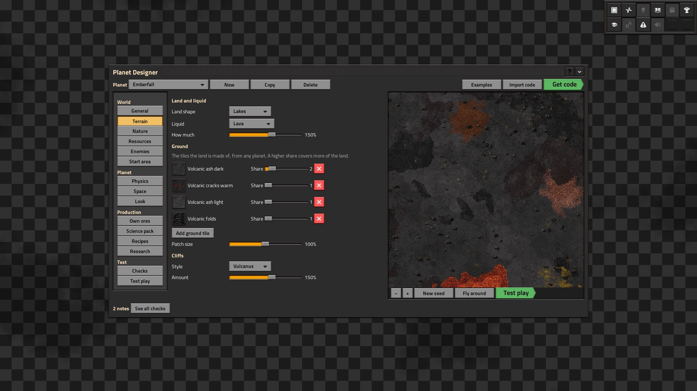

# Planet Workshop

A Factorio 2.1 + Space Age mod: design your own planets in an in-game Planet Designer, then add them to any Space
Age save and share them with other players as **planet codes** (like blueprint strings).

**Status: 0.9.1, the test build** (all seven build steps done; playtesting before the first public release).
What players see is in [docs/portal-description.md](docs/portal-description.md), the mod portal page, with
pictures in [docs/gallery](docs/gallery). Example planets are in [examples/](examples) (JSON; the mod carries them
as one code in `script/examples.lua`, made with `tools/make_code.py examples/*.json --lua ...`).

## How planet codes work

Factorio's planets are prototypes, made once while the game starts up. A running game can't create them, and the
loading game can't read files or saves. So the bridge is a startup setting:

1. The designer makes a code: `PW1:` + base64 of zlib-compressed JSON (`helpers.encode_string`).
2. The player pastes it into **Settings > Mod settings > Startup > Planet codes**. Several codes can be pasted one
   after another, separated by spaces.
3. After the restart, `data-updates.lua` decodes the codes in plain Lua (`lib/base64.lua`, `lib/inflate.lua`,
   `lib/json.lua`: the data stage has no `helpers`) and builds the prototypes (`prototypes/build.lua`).

Codes are only ever read as data, never run. Anything in a code that refers to something missing (a tile or item
from a mod that isn't installed, a typo) is left out with a message to the player, not a crash.

## The code format (version 1)

The JSON inside a code is a pack: `{"planets": [planet, ...]}`. A planet (see `lib/spec.lua` for every limit and
default, and `tests/planets/brimstone.json` for a full example):

| Field | What it is |
|---|---|
| `id` | 4-16 lower-case letters/digits, unique per planet; every prototype is named `pw-<id>-...` |
| `name`, `description`, `author` | shown in game |
| `look` | `picture` and `sky` (nauvis / vulcanus / gleba / fulgora / aquilo, or `auto`), and `tint` |
| `space` | `from` (the planet the route starts at), `length` (km), star-map `distance` / `orientation` / `magnitude`, `asteroids` (a Space Age route's mix) |
| `physics` | `gravity`, `pressure`, `magnetic_field`, `solar_power`, `day_length` (minutes), `freezing`, `lightning` |
| `terrain` | `shape` (lakes / big-lakes / island / archipelago / continents), `liquid` (water / lava / oil / ammonia / slime / none) and `liquid_amount`, `ground` (`{tile, share}` list) and `patch_size`, `cliffs` (`style`, `amount`), `plants` and `rocks` (`styles` list, `amount`), `decorations` |
| `enemies` | `kind` (none / biters / pentapods / demolishers) and `amount` |
| `ores` | the planet's own ores and fluids: `key`, `kind` (solid / fluid), `name`, `tint`, `base` (vanilla ore or well to look like), `mining_time`, `stack_size` |
| `resources` | what generates: `resource` (a resource or `@ore:<key>`), `frequency`, `size`, `richness`, `starting` (solids default to a patch near the landing spot) |
| `science` | its science pack: `name`, `tint`, `base` (pack to look like), `ingredients`, `count`, `time`, `category`, `only_here`, `spoil_minutes` |
| `discovery` | the discovery technology's `prerequisites`, `count`, `time`, `ingredients` |
| `recipes` | `key`, `name`, `ingredients`, `results`, `category`, `time`, `only_here`, `enabled` |
| `technologies` | `key`, `name`, `icon`, `prerequisites`, `count`, `time`, `ingredients`, `infinite`, `effects` (`unlock-recipe`, `change-recipe-productivity`, bonus modifiers) |

References to the planet's own things start with `@`: `@pack`, `@ore:<key>`, `@recipe:<key>`, `@tech:<key>`,
`@discovery`. Anything else names a vanilla or modded prototype. "Only here" recipes use a hidden surface property
`pw-<id>-here` that only that planet has.

## The Planet Designer

`scenarios/planet-designer` only switches the designer on (remote `start_designer`) and carries a tiny map
(`blueprint.zip`, a 64x64 map made with `--create` and turned into a scenario map with `factorio --map2scenario`),
so New game > Scenarios goes straight in without the map generator screen; everything else is in the
mod: `script/designer/state.lua` (the designs, in the code format, in `storage.designer`), `gui.lua` (the window
and the world/planet sections), `production.lua` (ores, science pack, recipes, research), `widgets.lua` (building
blocks; every input's tags say which field it changes), `preview.lua` (a preview surface per player) and
`init.lua` (events and actions), `checks.lua` (the Checks list) and `testplay.lua` (test play). A planet's own
ores show in the preview as hidden stand-ins of their base look, or as the real ores if the planet is loaded. Each
finished preview runs the starting-resources safety net, like the real planet's surface. Test play sets the
planet's surface properties on the preview (`LuaSurface.set_property`) and gives the tester their own force
(`pw-test-<player>`); freezing and lightning are planet-prototype only, so test play can't show them.

**Sharing** (`script/designer/share.lua`): codes come from `share.for_code` (designer-only fields, which start
with `_`, are left out; `mods` = the mods that created what the planet uses, from `prototypes.get_history`). An
import keeps `_original`; if the planet is changed and shared by someone else, it becomes their remix (new id,
author, `credits`). The share picture is `game.take_screenshot` of the preview with a card drawn by `rendering`
for 3 ticks (sprites draw under rectangles, so the planet's picture is rich text in a text object).

**Starting planet** (`script/startplanet.lua`): at `on_init` of a new freeplay game (tick 0) the planet's surface
is made and the force's spawn point put there. Freeplay handles `on_player_created` before mods, so its crash
site is switched off (remote `freeplay.set_disable_crashsite`) and made on the planet with the `crash-site`
library when the first player has been moved there. Deaths on the planet respawn there.

**Hand-made start areas** (`script/startarea.lua`, `script/designer/startedit.lua`): a planet given a seed
generates tile-for-tile like the preview on that seed (the `sameworld` test checks it), so a start area is stored
as *changes*: the seed, runs of changed tiles, things placed and things taken away (`start` in the code). Editing
takes a "before" snapshot of the fresh preview (after the safety net), puts the changes back, and opens the map
editor (`defines.controllers.editor`, which pauses the game, so it is un-paused); Save diffs the area against the
snapshot. The real planet sets the seed in `on_surface_created`, generates, runs the safety net, then applies the
changes. Own ores are written as `@ore:<key>` (the editor can't list hidden stand-ins, so the ore brush, a
selection tool, places them). The preview camera only draws charted ground, so the preview area is charted after each change.

## How a planet's world is generated

A running game can't make noise rules, so every planet and the designer preview use one **terrain kit**
(`lib/kit.lua`, defined in `prototypes/kit.lua`): named noise expressions whose numbers (ground shares, patch size,
plant and rock amounts, resource sizes) come from hidden map-gen controls in each planet's map settings.
`lib/mapgen.lua` turns a planet into those settings; the loader and the designer both call it, so the preview is
made by exactly the rules the finished planet gets (the designer test checks they match). Kit slot counts and
expressions should only ever be added to once released, or existing planets' new chunks would change. The
choices live in `lib/catalog.lua`.

- **Land:** the vanilla shapes reuse the game's elevation (with its starting lake); archipelago and continents are
  ours, calibrated by measurement (archipelagos about 60% sea, continents about 30%), with ragged land around the
  landing spot and, on water planets, a starting pond. The liquid amount slider is the game's water control.
- **Ground:** each tile gets its own patch noise and the highest wins, so tiles from different planets mix
  naturally and each tile's share sets how much of the land it covers.
- **Resources:** each resource takes a kit slot of its kind (starting / other, ore / fluid) in one shared patch set,
  so each starting resource gets a patch near the landing spot, like Nauvis' starting ores. `script/starting.lua` checks the first time a planet is
  visited and adds a small patch if a seed buried one (e.g. under lava).
- **Picture:** the planet that half or more of the ground comes from; otherwise the closest colour to each vanilla
  planet's own ground. **Sky:** the home planet of most of the ground.
- Things worth knowing: Space Age's oil wells, lithium brine and fluorine vents make snow and ice around themselves
  on icy ground; pentapod nests can only stand in shallow swamp, which is why slime has wide wetlands.

## Developing

- `tools/run_tests.sh [bridge terrain designer startarea roundtrip sameworld testplay startplanet share scenario codec added]` runs the headless test suites in a throwaway folder (never
  `~/.factorio`). `KEEP=1` keeps the folder for reading logs.
  - **bridge**: the test planets (including Frostbite, which is full of mistakes) plus a broken code and a
    too-new code, loaded into a new game: prototypes, generated terrain and ore, research, and real assemblers
    showing the pack is only made on its planet.
  - **terrain**: eight test planets' generated worlds: land shapes, ground shares, liquids, cliffs, plants, rocks,
    enemies, pictures and skies, starting resources on several seeds, and the safety net on a buried seed.
  - **designer**: the window and its real controls, the preview, Get code / Import, New / Copy / Delete, and
    that the preview's map settings match the finished planet's.
  - **roundtrip**: the planet the designer suite built with the real controls (own ore and fluid, pack, recipe,
    research) is loaded from its code in a new game and checked.
  - **startarea**: a start area made through the real buttons and the editor (water, copper, the own-ore brush,
    a tree taken away, a chest that isn't kept), shown in the preview, in the code, and Cancel; **roundtrip**
    then loads it and checks the real planet has every change. **sameworld**: preview and planet on one seed
    are identical.
  - **share**: remixes (unchanged imports stay the original; changed ones get their own id and credit), Copy of
    someone else's planet, a three-planet pack, the mods a code lists, a missing mod in Checks, the picture
    call, and the author in the planet's description. (bridge also checks a missing mod is reported.)
  - **homestead**: a new game on a starting planet with the biggest start area (a lake on the landing spot, ore
    fields, a ring road): everything there, and the player, crash site and respawns on dry land.
  - **fuzz**: 60 random planets, half broken in every way (`tools/fuzz_planets.py`; `FUZZ_SEED`, `FUZZ_COUNT`):
    the game starts, every surface generates, every designer section of every planet opens, very long texts.
  - **monkey**: 7,200 random clicks, picks, slides, ticks and typing in the designer; **monkeyload** then loads
    every planet it made as real planets.
  - **saveload**: `tests/fixtures/designer-0.9.0-test-play.zip` (made in a real game, as tests can't save) loads
    mid test play and carries on.
  - **existing**: a save with Brimstone in use loaded with its code removed, changed, and with a starting planet
    set afterwards (tests/pw-setup builds on it while the map is made).
  - **startplanet**: a new game made with Verdant as the starting planet: the player, crash site, spawn point,
    discovery, charted start, Nauvis still there, and respawning on Verdant.
  - **testplay**: every kind of check on a planet full of mistakes (and none once fixed), a loaded planet's real
    ores in the preview, and test play: the body, kit, force, research, physics, enemies, coming back, the
    options, and dying.
  - **scenario**: the Planet Designer scenario starts on a headless server without errors.
  - **codec**: codes made in game with `helpers.encode_string` read back by the mod's decoder; a 1.5 MB planet;
    428 damaged or cut codes that must fail politely; JSON edge cases.
  - **added**: the codes added to a save that was made without them.
- `tools/mp_test.sh` (needs a desktop): a headless server and a real client run the designer together; passes if
  neither desyncs.
- `tools/make_code.py planet.json` makes a code from a planet JSON file (`--decode CODE` shows what's inside one).

## Releasing
- `tools/package.sh` makes `dist/planet-workshop_<version>.zip` (for testers, or the portal).
- `tools/publish.py --first` publishes it on the mod portal with the description and gallery; later releases are
  `tools/publish.py` (bump `info.json` and the changelog first), `--details` updates the page text, `--gallery` the
  pictures. It reads the API key from `~/.config/factorio/modportal-api-key`.
- The thumbnail and gallery are in-game screenshots (no drawn or generated art).

## Licence

MIT (see LICENSE). No images are shipped: everything is vanilla art, tinted.
